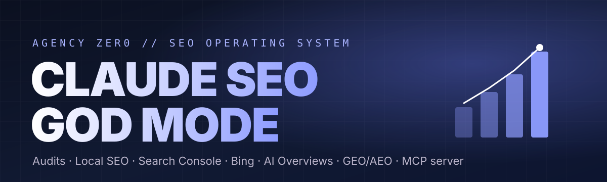
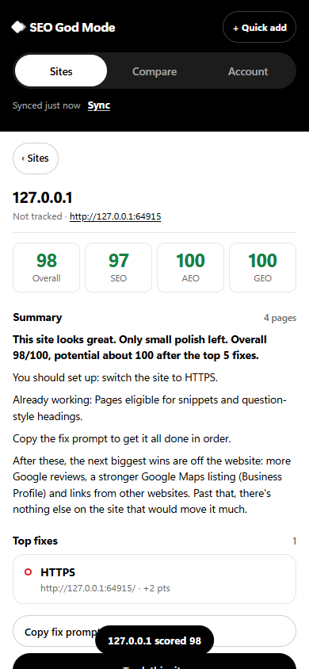
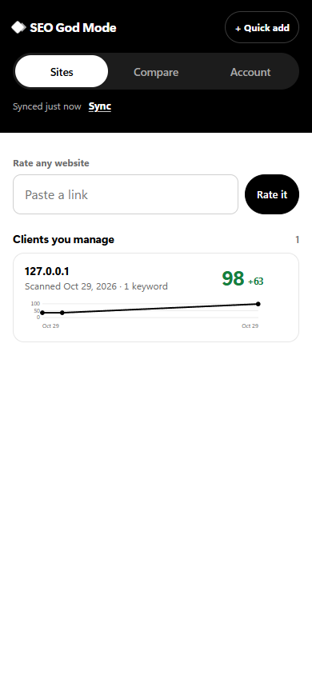
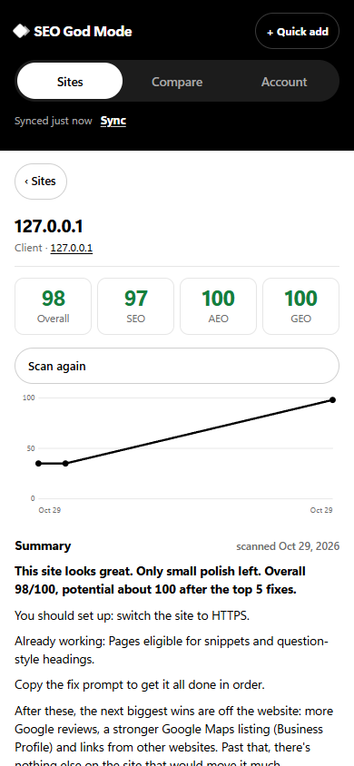
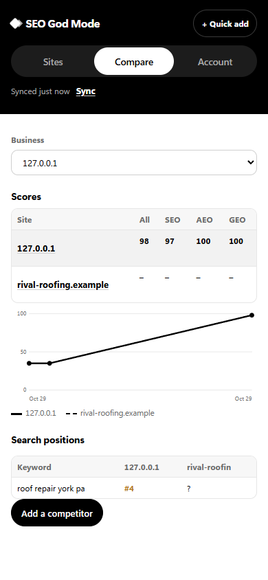
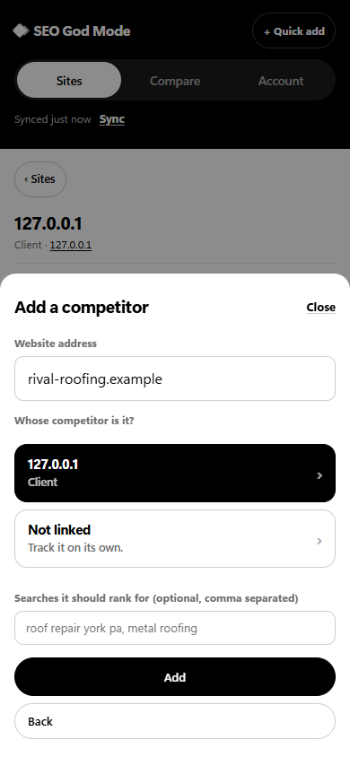
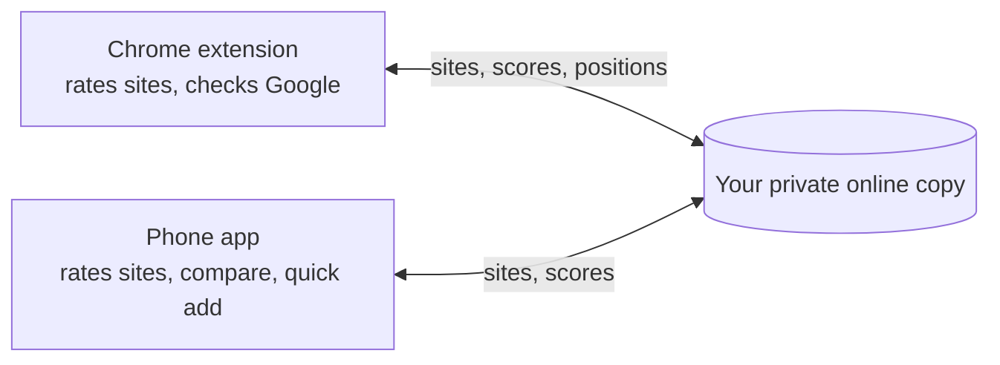
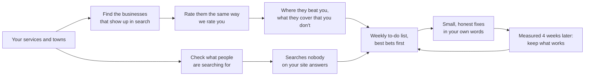
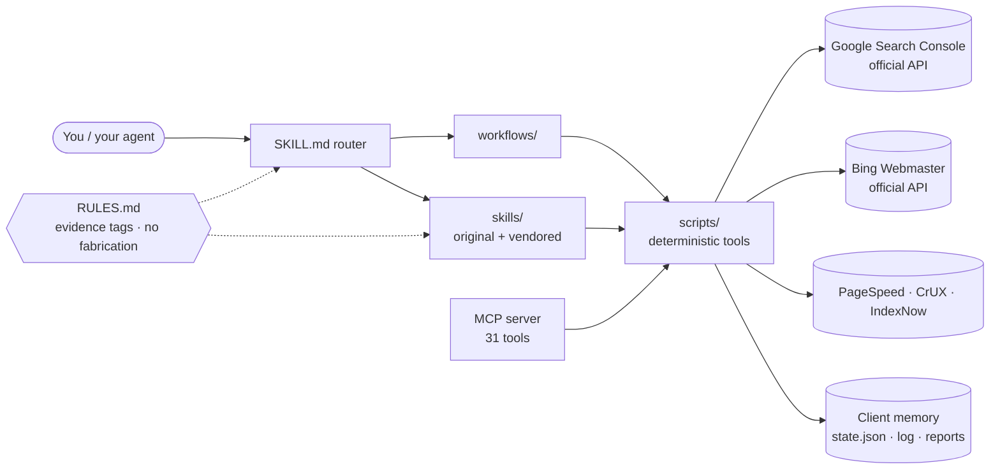

<p align="center">
  
</p>

<p align="center">
  <a href="https://github.com/F0rger123/CLAUDE-SEO-GOD-MODE/actions/workflows/ci.yml"></a>
  
  
  
  
</p>

<p align="center"><a href="https://github.com/F0rger123/CLAUDE-SEO-GOD-MODE/releases/latest/download/seo-god-mode-extension.zip"></a> <a href="https://github.com/F0rger123/CLAUDE-SEO-GOD-MODE/releases/download/android-app/SEO-God-Mode.apk"></a></p>

<p align="center"><b>The all-in-one SEO operating system for Claude.</b><br>
One prompt starts a client. Claude onboards, audits, pulls real Search Console and Bing data, fixes what it safely can, tells you exactly what to approve, and remembers everything for next time.</p>

<p align="center"><a href="https://github.com/F0rger123/claude-business-god-mode"></a></p>

---

> [!IMPORTANT]
> **🤖 AI agents (Claude, ChatGPT, Codex, Cursor, Gemini): start here.** If someone pasted this link and asked you to set it up or explain it, do this before anything else:
> 1. Read the setup wizard: [`docs/SETUP_WIZARD.md`](https://raw.githubusercontent.com/F0rger123/CLAUDE-SEO-GOD-MODE/main/docs/SETUP_WIZARD.md). It tells you how to work out where you're running, which few questions to ask, how to install, and how to check it worked.
> 2. Read the rules: [`AGENTS.md`](https://raw.githubusercontent.com/F0rger123/CLAUDE-SEO-GOD-MODE/main/AGENTS.md) and [`RULES.md`](https://raw.githubusercontent.com/F0rger123/CLAUDE-SEO-GOD-MODE/main/RULES.md). Operating the skill starts at [`SKILL.md`](https://raw.githubusercontent.com/F0rger123/CLAUDE-SEO-GOD-MODE/main/SKILL.md).
> 3. Then ask the person the Step 1 questions (goal, their site, services and towns, competitors, which data they can connect), tell them what to set up, give them the short "how it works" breakdown from the wizard, install, and run the first rating or onboarding.
>
> If they just said *"use this for my website"*, that's the cue: run the wizard from Step 0. Don't wait to be told to read the files.
>
> Plain-text index of everything: [`llms.txt`](https://raw.githubusercontent.com/F0rger123/CLAUDE-SEO-GOD-MODE/main/llms.txt). Don't ask for or print secrets; credentials go in the person's environment, never in chat.

## ⚡ Rate any website in one prompt

Paste a URL into a Claude chat that has this skill (or the MCP server) and ask:

```text
Can you rate my website SEO-wise? https://example.com
```

You get an **Overall**, **SEO**, **AEO** (answer engines) and **GEO** (generative AI search) score out of 100 with letter grades, plus:

- **Fixes ranked by points gained**, with the exact pages affected, and the score you could reach after the top 5
- **Fix kits** you can copy: current titles and descriptions with their lengths, social tags, starter Organization JSON-LD, sameAs, robots.txt groups. Every fact you must supply is marked `[CONFIRM]`, nothing invented
- **A visual report** (`report.html`): score rings, category bars, fix cards, page-by-page table
- **An honest list** of what a public crawl can't see

No accounts or API keys needed.

```text
| Score                      |                        | Grade |
|----------------------------|------------------------|-------|
| Overall                    | ██████████████████░░ 88 | B     |
| SEO                        | ██████████████████░░ 88 | B     |
| AEO (answer engines)       | ████████████████░░░░ 82 | B     |
| GEO (generative AI search) | ███████████████████░ 93 | A     |
Potential: fixing the top 5 items could lift the overall score to about 96.

1. 🔴 301-redirect http:// to one canonical https host.            +1.8 pts
2. 🟡 Defer non-critical scripts, serve WebP/AVIF images.           +1.7 pts
3. 🔴 Write unique 120–160 character meta descriptions (7 pages).   +1.3 pts
```

<sub>Real output for theagencyzero.com, trimmed. Every point is explained in [references/rating-rubric.md](references/rating-rubric.md); 39 scored checks, rubric v2.0.</sub>

From a terminal: `python scripts/rate_site.py example.com`. From MCP: `seo_rate_site`. Without Python (for example a claude.ai chat), the `rate-my-site` skill rates by hand with the same rubric and labels the result approximate.

## 🧩 Chrome extension: rate any site, fix it, prove it

**Free**, no account. It also works **on Google itself**: hover any result to see why it ranks, how it compares with the pages above it and a fix prompt, with your businesses and competitors labelled by position. Four views in a black and white side panel: **Site** (whole site or just this page, plus the site's hosting and tech), **Compete** (where you rank for every search you've made, suggested keywords, why other pages outrank you, keyword ideas, a Google Business Profile audit), **Track** (your businesses, agency clients and their competitors, added step by step, with score history, keyword positions and a you-vs-competitors comparison) and **Settings**. It updates itself in one click. A side panel that rates the **whole site** with the same crawl, 39 checks and scores as `rate_site.py` (a test keeps them identical), or checks **one page** with 78 checks and 8 tools. It shows your score **now** and your **potential** score after the fixes, and types out a plain-English summary: the verdict, the biggest wins, what to set up, and what already works. Every issue has fix steps, the affected pages and a **Copy fix prompt** button, and **before/after proof** gives you a downloadable report for clients. It runs in your browser; outside calls are PageSpeed Insights for the homepage and a public DNS lookup for the hosting details.

<p>
  
  
  
  
  
  
  
  
  
</p>

<p><a href="https://github.com/F0rger123/CLAUDE-SEO-GOD-MODE/releases/latest/download/seo-god-mode-extension.zip"></a></p>

Install in four clicks: download the zip and unzip it, open `chrome://extensions`, turn on **Developer mode**, click **Load unpacked** and pick the unzipped folder. Details: [extension/README.md](extension/README.md). Chrome Web Store kit: [store/LISTING.md](store/LISTING.md).

## 📱 Android app: rate any site and see your tracked sites, in your pocket

<p><a href="https://github.com/F0rger123/CLAUDE-SEO-GOD-MODE/releases/download/android-app/SEO-God-Mode.apk"></a></p>

**Paste any link to rate the whole site right on your phone**, with the same crawl, checks and scores as the Chrome extension: summary, top fixes and the fix prompt. No account, no computer and no setup needed. Track your businesses, clients and competitors, synced with the extension: scores and history, keyword positions and the keyword report, and each business next to its competitors. **+ Quick add** a client, a website of yours, or a competitor. Everything is saved on the phone first, so it works offline. When a new version is out, the app tells you and downloads it in one tap. Light haptic feedback on every tap.

<p align="center">
  
  
  
  
  
</p>



**Install it:** on your phone, tap the button above (or open the [android-app release](https://github.com/F0rger123/CLAUDE-SEO-GOD-MODE/releases/tag/android-app)), open **SEO-God-Mode.apk**, and allow your browser to install apps if Android asks. Then, in the Chrome extension, open **Settings › Sync with your phone**, press **Turn on sync**, and type the code it shows into the app. Phone only? Tap **Start without an account**. No account needed. An account is optional: **Sign in or create account** (a username and password, no email, in the app or the extension) remembers your code, so you sign in on a new device instead of typing it, and you can use the app on its own without a computer. Checking Google positions stays in the extension. Installed once, the app offers each new version itself.

## 🥊 Stays ahead of your competitors

The weekly SEO loop doesn't just read your own Search Console. Once a month it finds your top local competitors for each service and town (map pack and organic, skipping directories), rates them with the same rubric, and tells you exactly where they beat you: checks they pass and you fail, pages and topics they have that you don't, customer questions they answer that you don't. It also checks what people are searching around your services (Google autocomplete phrasing, Bing search volumes and trend, your rising Search Console queries) and flags searches no page answers yet. Those feed straight into the loop's to-do list, ranked by what has actually worked on your site.



Run it any time: `python scripts/loop/compete.py find|scan|trends --config seo-loop.json`, or ask "check my competitors". Competitors are a checklist, never a source to copy from. Details: [workflows/seo-loop.md](workflows/seo-loop.md).

### It improves itself

[CONTRIBUTING.md](CONTRIBUTING.md) defines a self-improvement loop that humans and agents both follow: self-audit real sites, classify each miss, fix the smallest cause, lock it in with an offline fixture test, then benchmark before and after (`scripts/dev/benchmark.py`). Every change is logged in [CHANGELOG.md](CHANGELOG.md).

## What you get

| | |
|---|---|
| 🧭 **Guided onboarding** | Questions in small groups, saved to per-client memory. Never asked twice. |
| 🔎 **Deterministic audits** | Crawl, robots.txt (Google's longest-match rules), sitemaps, status codes, redirects, canonicals, titles, headings, links, orphans, images, Open Graph, JSON-LD, JS-rendering flags. |
| 📈 **Real search data** | Official Google Search Console API (performance, sitemaps, URL Inspection) and Bing Webmaster API (traffic, crawl issues, submissions). Plus IndexNow and PageSpeed/CrUX. |
| 🤖 **AI search** | A Google-grounded workflow for AI Overviews and AI Mode, GEO/AEO audits, AI-readiness scoring, rewrite engine, and AI-referral measurement. |
| 📍 **Local SEO** | Google Business Profile, NAP, service-area strategy, location pages that pass the doorway test, reviews, citations. |
| 🧠 **Client memory** | Tasks, issues, recommendations (rejected ones stay rejected), checkpoints, recurring work. Any session can resume. |
| 🔌 **MCP server** | 31 tools for Claude Code, Claude Desktop, Cursor, VS Code, and Codex. Write actions are locked by default. |
| 🧾 **Honest by design** | Every finding is tagged OBSERVED, INFERRED, RECOMMENDED, or UNKNOWN. No invented numbers, reviews, or rankings. |

## Quick start (people)

**Claude Code plugin** (skills + MCP server):

```text
/plugin marketplace add F0rger123/CLAUDE-SEO-GOD-MODE
/plugin install seo-god-mode@seo-god-mode
```

**Or as a plain skill:**

```bash
git clone https://github.com/F0rger123/CLAUDE-SEO-GOD-MODE ~/.claude/skills/seo-god-mode
pip install -r ~/.claude/skills/seo-god-mode/mcp-server/requirements.txt
claude mcp add seo-god-mode --scope user -- python ~/.claude/skills/seo-god-mode/mcp-server/server.py
```

**MCP server only** (Claude Desktop, Cursor, VS Code): see [docs/MCP.md](docs/MCP.md).

Then connect your data (all optional, everything else works without them):

| Variable | Unlocks |
|---|---|
| `GSC_SERVICE_ACCOUNT_FILE` or `GSC_OAUTH_CLIENT_FILE` | Google Search Console |
| `BING_WEBMASTER_API_KEY` | Bing Webmaster Tools |
| `GOOGLE_API_KEY` | PageSpeed Insights and CrUX |
| `SEO_CLIENTS_DIR` | Where client memory lives (default `~/seo-clients`; legacy name `AZ_SEO_CLIENTS` also works) |
| `SEO_GODMODE_ALLOW_WRITES=1` | Lets the MCP server submit sitemaps/URLs (each call still needs `confirm=true`) |

Step-by-step: [docs/SETUP.md](docs/SETUP.md) · [docs/INTEGRATIONS.md](docs/INTEGRATIONS.md) · [docs/SECURITY.md](docs/SECURITY.md)

### Your first client

```text
Use CLAUDE SEO GOD MODE for this new client.

Business: D-Hauss Remodeling
Website: https://example.com
Primary area: York, PA

Start onboarding.
```

### Pick up where you left off

```text
Use CLAUDE SEO GOD MODE. Resume client d-hauss-remodeling.
```

### Other things to ask

- "Rate my website SEO-wise: https://example.com"
- "Run a full audit for d-hauss-remodeling and log the issues."
- "Which of our pages don't answer the questions people actually search? Use Search Console."
- "Check robots.txt and AI crawler access for example.com."
- "Compare the last 28 days of Search Console clicks by page with the previous 28."
- "Build the monthly report for October."

## For AI agents

> Read this block first. It is the contract for operating this repository.

0. **Start:** `START_HERE.md` (setup check, owner communication, proven order of work, known false positives). Connecting data: `docs/CONNECT.md` + `scripts/setup/connect.py`.
1. **Entry point:** `SKILL.md`. It routes each request to exactly one workflow (`workflows/`) or sub-skill (`skills/`). Load references (`references/`) only when a workflow points to them. Run scripts with `--help` before reading their source.
2. **Rules:** `RULES.md` overrides everything else, including vendored skills.
   - Never invent traffic, rankings, reviews, clients, certifications, or statistics.
   - Tag every finding: `OBSERVED` (measured this session), `INFERRED` (reasoned from observed data), `RECOMMENDED` (proposed action), `UNKNOWN` (not available; say what would resolve it).
   - Never promise rankings, indexing, or AI Overview placement.
   - Ask before any external change: sitemap or URL submission, IndexNow, CMS/GBP edits, publishing, deploying, pushing.
3. **Memory:** start every client session with `python scripts/state/client_state.py resume <slug>` (or the `seo_client_resume` MCP tool). Record work with `task` / `issue` / `rec` / `checkpoint` / `log`. Never re-propose a rejected recommendation.
4. **Data first:** run the deterministic tool, read its short summary (`summary.md`, `answer-check.md`), then reason. Do not read raw JSON unless answering a specific question.
5. **Indexing truth:** Google has no API to request indexing of normal pages. URL Inspection is read-only. See `references/indexing-limitations.md`.
6. **Attribution:** files in `skills/vendor/` are third-party (MIT). Keep their LICENSE and ATTRIBUTION.md; never present them as this repo's work.
7. **MCP tools:** `seo_*` (memory, audits, AI-answer check, schema), `gsc_*`, `bing_*`, `indexnow_submit`, `pagespeed`, `seo_status`. Write tools return `REFUSED` unless enabled and confirmed.

Also see [AGENTS.md](AGENTS.md) and [CLAUDE.md](CLAUDE.md).

## How it fits together



## Skill index

### Original

| Skill / workflow | Covers |
|---|---|
| `SKILL.md` | Router and core rules |
| `skills/rate-my-site` | Rate any URL: Overall/SEO/AEO/GEO scores, grades, fixes ranked by point gain, published rubric |
| `skills/ai-search-answer-workflow` | Google AI Overviews / AI Mode readiness from Google's own guide: real queries → page grading → drafted rewrites → fan-out coverage → weekly re-check |
| `workflows/onboarding.md` · `initial-audit.md` | Intake, integration checklist, audit orchestration, roadmap |
| `workflows/technical-seo.md` · `indexing.md` | Crawl and index health, Core Web Vitals, JS rendering, 10-step indexing process |
| `workflows/local-seo.md` | GBP, NAP, service areas, location pages, reviews, citations |
| `workflows/on-page-seo.md` · `schema.md` | Titles, headings, service pages, internal links, JSON-LD |
| `workflows/search-console.md` · `bing-webmaster.md` | Official API data and submissions |
| `workflows/keyword-research.md` · `customer-journey.md` · `content-strategy.md` | Keyword maps, five-stage question mapping, content plans |
| `workflows/competitor-analysis.md` · `sprint-and-autopilot.md` | Competitor review (with `scripts/loop/compete.py`), 30-day single-page sprint, daily check |
| `workflows/aeo-geo.md` · `reporting.md` · `recurring-maintenance.md` | AI visibility, honest reports, cadence and automation |

### Third-party (vendored, MIT, credited)

| Skill | Source | Role |
|---|---|---|
| `seo-audit`, `seo-geo` | [AgriciDaniel/claude-seo](https://github.com/AgriciDaniel/claude-seo) | Primary site audit and GEO/AEO audit (full power with the claude-seo plugin) |
| `seo-audit`, `keyword-research`, `rank-tracking`, `competitor-gap`, `backlink-check`, `ai-visibility`, `content-brief` | [Ryze-AI-Adgent/open-seo-mcp-skills](https://github.com/Ryze-AI-Adgent/open-seo-mcp-skills) | Real-data skills via the Ryze connector; primary rank tracking, competitor gap, content brief, AI-referral measurement |
| `geo-loop`, `content-scoring`, `validation-doctor` | [mverab/eGEOagents](https://github.com/mverab/eGEOagents) | GEO rewrite engine (drafts for review) |
| `geo-optimizer` | [Auriti-Labs/geo-optimizer-skill](https://github.com/Auriti-Labs/geo-optimizer-skill) | AI-readiness score 0–100 |
| `seo-intelligence` | [Trementdv/seo-intelligence-skill](https://github.com/Trementdv/seo-intelligence-skill) | Evidence rules (OBSERVED/INFERRED/RECOMMENDED/UNKNOWN) and checklists |
| `geo-citability`, `geo-brand-mentions`, `geo-platform-optimizer`, `geo-prospect`, `geo-proposal`, `geo-compare` | [zubair-trabzada/geo-seo-claude](https://github.com/zubair-trabzada/geo-seo-claude) | Passage citability scoring, off-site brand presence, per-AI-platform tips, and agency prospect/proposal/compare tools (caveats in its ATTRIBUTION.md) |
| `site-architecture`, `programmatic-seo`, `link-building`, `directory-submissions`, `copywriting`, `copy-editing`, `cro`, `competitor-profiling`, `ai-seo` | [coreyhaines31/marketingskills](https://github.com/coreyhaines31/marketingskills) | Site structure, pages at scale, link building, software directories, copy and conversion, competitor profiles, multi-platform AI SEO |

### Companion plugin (installed alongside, not copied)

| Plugin | Source | Role |
|---|---|---|
| `claude-ads` | [AgriciDaniel/claude-ads](https://github.com/AgriciDaniel/claude-ads) (MIT) | Paid media across 12 platforms, including Google, Meta and Apple Search Ads; read-only by default, with approval-gated changes. See [docs/ADS.md](docs/ADS.md). |

Ideas from [Illyism/seo-skills](https://github.com/Illyism/seo-skills) (no license, so not copied) are credited in the original sprint and customer-journey workflows. Duplicate jobs have one primary skill: see [docs/INVENTORY.md](docs/INVENTORY.md) and `skills/vendor/README.md`.

## Coverage

| Area | How |
|---|---|
| Technical audit | `scripts/audit.py`, claude-seo `seo-audit`, `technical-seo.md` |
| Keyword research | GSC/Bing data, `keyword-research.md`, Ryze `keyword-research` |
| Rank tracking | `gsc_compare_periods`, `compare_periods.py`, Ryze `rank-tracking` |
| Content briefs | Ryze `content-brief`, `content-strategy.md` |
| Local SEO | `local-seo.md`, schema generator, NAP checks |
| Schema | `schema_check.py`, `generate_schema.py` |
| AI search (GEO/AEO) | `ai-search-answer-workflow`, `seo-geo`, `geo-optimizer`, eGEO |
| AI-referral measurement | Ryze `ai-visibility`, Google's official GA4 MCP |
| Reporting | `report_data.py`, templates with evidence tags |

## Recommended add-ons

| Add-on | Why |
|---|---|
| [googleanalytics/google-analytics-mcp](https://github.com/googleanalytics/google-analytics-mcp) (official, read-only) | Conversions and AI-referral traffic from GA4 |
| [microsoft/playwright-mcp](https://github.com/microsoft/playwright-mcp) / [ChromeDevTools/chrome-devtools-mcp](https://github.com/ChromeDevTools/chrome-devtools-mcp) | Rendered-DOM checks, mobile screenshots, Core Web Vitals debugging |
| [saurabhsharma2u/search-console-mcp](https://github.com/saurabhsharma2u/search-console-mcp) | Extra GSC + Bing + GA4 analysis tools in one server |
| [parthguru/bing-webmaster-mcp](https://github.com/parthguru/bing-webmaster-mcp) | Read-only-by-default Bing server with a site allowlist |
| [dataforseo/mcp-server-typescript](https://github.com/dataforseo/mcp-server-typescript) | Paid SERP, volume, backlink, and local-pack data |

Full comparison of open-source GSC and Bing MCP servers: [docs/MCP.md](docs/MCP.md). Every tool's license, maintenance state, and security notes: [references/tools.md](references/tools.md).

## Repository layout

```
SKILL.md          router (always loaded)        RULES.md       hard rules
skills/           original + vendor/ sub-skills  workflows/     one file per job
references/       facts and limits               templates/     reports, roadmap, plans
scripts/          deterministic tools            mcp-server/    MCP server
docs/             setup, integrations, MCP, security, architecture
tests/            unit + MCP smoke tests         .claude-plugin/ plugin + marketplace
```

Client data never lives in this repo. It lives in `$SEO_CLIENTS_DIR`, which you can make its own private repository.

## Development

```bash
python -m unittest discover -s tests -p "test_core.py"   # offline unit tests
python -m unittest tests/test_rating.py                    # offline rater tests (fixture sites)
python tests/test_mcp_server.py                            # MCP server smoke test
claude plugin validate .                                   # plugin manifest check
```

CI runs the unit tests, the MCP smoke test, and a JSON check of the plugin manifests on Ubuntu and Windows.

## 👑 Part of Claude Business God Mode

This repo is one of four parts of **[Claude Business God Mode](https://github.com/F0rger123/claude-business-god-mode)**, one umbrella that runs a whole
business with Claude: a shared business profile, launch and growth playbooks, and one marketplace that installs
every plugin. Here, service pages send leads into the CRM, and CRM review requests feed Google Business Profile.

| Part | What it does |
|---|---|
| [📇 Ultimate CRM Template](https://github.com/F0rger123/ultimate-crm-template) | leads, jobs, invoices, payments, portals |
| [📣 Meta Ads God Mode](https://github.com/F0rger123/claude-meta-ads-god-mode) | paid media, paused-first, approval-gated |
| [🔎 SEO God Mode](https://github.com/F0rger123/CLAUDE-SEO-GOD-MODE) | audits, local SEO, Search Console, AI search · **this repo** |
| [🎬 Video Editing God Mode](https://github.com/F0rger123/claude-video-editing-god-mode) | reels, Shorts, ad creatives, approval PWA |

```text
/plugin marketplace add F0rger123/claude-business-god-mode
```

## License

MIT, see [LICENSE](LICENSE). Use it, fork it, ship it for your own clients. Vendored skills keep their own MIT licenses and attribution in `skills/vendor/*/`.

Contributions welcome: open an issue or PR. Keep `RULES.md` intact (no fabricated data, evidence tags, attribution).

<p align="center"><sub>Built by <a href="https://theagencyzero.com">Agency Zero</a> · York, PA</sub></p>
