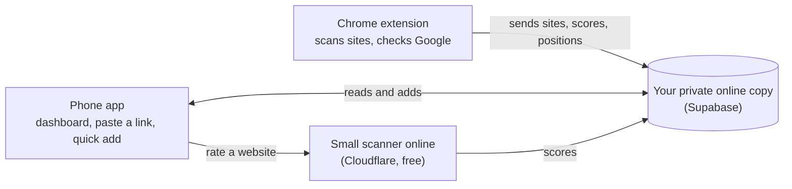

# Plan: SEO God Mode for Android, synced with the Chrome extension

Status: steps 1 to 4 and 6 built (2026-10-28): database, extension sync, the app, and the APK build. Step 5 (rating sites from the phone) is not started. Since 2026-10-29 (extension 1.15) devices pair with a sync code instead of an email sign-in.

## What you get

An Android app (APK) with the same black-and-white look as the extension:

- **Dashboard:** your businesses, clients and competitors, each with its latest Overall / SEO / AEO / GEO score, score chart and keyword positions.
- **Paste a link:** rate any website from the phone and see the scores, top fixes and fix prompt.
- **Compare:** a business next to its competitors, side by side, using the same data as You vs competitors in Track.
- **Quick add:** add a client, website or competitor from the phone (Android's Share menu works too: share a link from Chrome to the app).
- **Sync both ways:** add or remove a site, keyword or competitor on either device and it shows up on the other within seconds.

## What stays on the computer

- **Checking Google positions** stays in the Chrome extension. Google blocks automated searches from apps and servers and shows robot checks. The phone shows the positions the extension recorded.
- **Hover cards on Google** are extension-only.

## How it fits together

## Pieces

1. **Supabase project (the online copy).** Tables: sites (origin, name, role, competitor of, keywords), score points, keyword positions, keyword reports and latest scans. Each row belongs to one signed-in user, and the database only ever returns your own rows. Sign-in is an emailed link, so there is no password to remember.
2. **Extension sync (1.14).** A "Sync with phone" switch in Settings with a sign-in by email. When it's on, every change the extension saves is also sent online, and changes made on the phone are pulled in. Off by default; without it nothing leaves your computer, as now. The privacy page is updated to say what is sent.
3. **Phone app.** A web app built from the extension's own code (the same scoring rules, breakdown and fix prompts), packaged as an APK with Capacitor. It works offline with the last synced data.
4. **Scanner for the phone.** A phone app can't read other websites the way an extension can, so "rate this website" from the phone runs on a small Cloudflare Worker using the same scoring code. Free tier: 100,000 requests a day.
5. **Building the APK.** GitHub Actions builds the APK on every release and attaches it to the GitHub release, like the extension zip. No Android Studio needed on your computer. You install it by opening the file on the phone (allow "install unknown apps" for your browser once).

## Order of work

1. You create the Supabase account and project (below).
2. Database tables and sign-in, with tests that one user can never see another's rows.
3. Sync in the extension, behind the off-by-default switch. Tested with two browser profiles.
4. Phone app screens, tested at phone size with made-up data.
5. Cloudflare scanner (needs a Cloudflare account; asked for at that step).
6. APK build in GitHub Actions, then install on your phone.

## Accounts and cost

| Account | Needed for | Cost |
|---|---|---|
| Supabase | Sync and sign-in | Free tier (500 MB database, 50,000 monthly users). Free projects pause after a week with no use and wake on the next visit. |
| Cloudflare | Rating websites from the phone (step 5) | Free tier |
| Google Play developer | Only if you want it in the Play Store | One-time $25. Not needed for the APK. |

## Never

- The Supabase "service_role" or secret key never goes into the extension, the app, chat or the repo. Only the project URL and the publishable (anon) key are used in the apps; they are safe to ship because the database rules decide what each user can read.
- No real client data in screenshots or tests.
