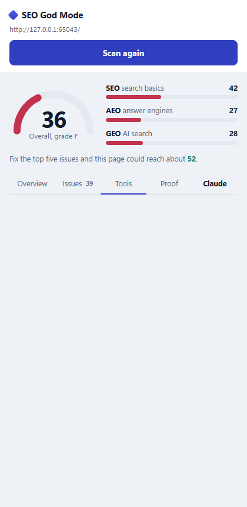

# CLAUDE SEO GOD MODE: Chrome extension

A side panel that scans the page you're on for **SEO, AEO (answer engines) and GEO (AI search)**, explains each problem with step-by-step fixes for your platform, writes **ready-to-paste Claude prompts** to fix them, and keeps **before/after proof** you can hand to a client.

  
  
  
  
  

## Install (2 minutes, no store needed)

1. **[Download the extension zip](https://github.com/F0rger123/CLAUDE-SEO-GOD-MODE/releases/latest/download/seo-god-mode-extension.zip)** and unzip it.
2. In Chrome, open `chrome://extensions` and turn on **Developer mode** (top right).
3. Click **Load unpacked** and pick the unzipped folder.
4. Pin the extension, open any website, and click its icon. The side panel opens; press **Scan this page**.

The first scan of each site asks for access to that site. The extension needs it to read the page, `robots.txt` and the sitemap. It works with Chrome 116+ and other Chromium browsers (Edge, Brave, Arc).

## What it checks (78 checks)

| Area | Checks |
|---|---|
| **SEO** (50) | **Crawl & index:** noindex, HTTP status, robots.txt, sitemap (exists, listed in robots.txt, includes this page), real 404s, canonical (present, single, self-referencing), HTTPS, http→https, mixed content, meta refresh, raw-HTML content, hreflang. **On-page:** title length and brand, meta description, one H1, H1/title match, heading order, empty headings, clean URL, lang, doctype/charset/favicon, Open Graph, Twitter card, content depth, text-to-code ratio. **Links & images:** internal links, descriptive anchors, nofollow on internal links, alt text, dimensions, WebP/AVIF, srcset. **Speed:** LCP, CLS, TTFB, lazy-loaded hero image, render-blocking scripts, requests and DOM size, compression, mobile viewport. **Structured data:** valid JSON-LD, any schema, breadcrumbs, WebSite, complete Article, no self-serving review stars |
| **AEO** (12) | Snippet eligibility, large image previews, a direct answer up top, a definition sentence ("X is a…"), question headings, FAQ matching its schema, quotable paragraphs, no walls of text, H2 sections, lists/tables, plain-language reading level, freshness |
| **GEO** (16) | AI search crawlers, AI user-fetch agents, Bing access, business schema, complete entity details, sameAs, knowledge-graph profiles (Maps, LinkedIn, Wikidata), location, contact details, About/Contact links, author/date, outside sources, authoritative sources, specific figures, reviews/testimonials, llms.txt (info only) |

Scores are out of 100 per area. **Overall = 60% SEO + 20% AEO + 20% GEO**, the same weighting as the repo's `rate_site.py`. Every result is tagged **OBSERVED** (measured on the live page), **INFERRED** (a stated heuristic) or **UNKNOWN** (couldn't measure). Nothing is guessed.

## Tabs

- **Overview:** the five biggest wins, a per-area breakdown (one bar segment per check; tap a row to jump to those issues), and quick page facts.
- **Issues:** every failed check grouped by area, with SEO/AEO/GEO filters, search, and a "show passing" toggle.
- **Tools:** Google result preview (title width measured in pixels), share preview, heading outline, schema inspector with Rich Results and schema.org links, a 17-crawler access table (search, user-fetch and AI-training bots), links table, images table, page facts, and quick links (PageSpeed, `site:` searches, ask ChatGPT/Perplexity about the brand, Apple Maps).

- **Fix steps:** failed checks ranked by how many points each one is worth. Open a check to see why it matters, steps tailored to the detected platform (WordPress, Shopify, Wix, Squarespace, Webflow, Next.js, Astro), and a **Copy Claude prompt** button.
- **Passed:** what to keep.
- **Before / after:** mark a scan as **BEFORE**, make the fixes, scan again. The tab shows score changes and every check that was fixed, improved or regressed. **Download proof report** saves a dated, self-contained HTML page for the client.
- **Claude:** exports (scan JSON, checks CSV, issue list) plus one "fix everything" prompt in priority order, with built-in rules: no invented facts (`[CONFIRM]` placeholders), keep the design, verify the live page after deploying, and do CDN-level HTTPS changes in the CDN settings rather than in code.

## Privacy

Everything runs in your browser. Scan history is stored in `chrome.storage.local` on your device (the last 25 scans per page). The extension sends nothing anywhere except requests to the site you're scanning (its page, `robots.txt`, sitemap, `llms.txt`, a random URL to test for 404s, and its `http://` address). There's no analytics and no account.

## Limits

- Scores cover one page plus its site files. For a whole-site crawl, use `python scripts/rate_site.py <site>` or the MCP tool `seo_rate_site`.
- Load speed comes from your own visit (device and network). Search Console and PageSpeed Insights have field data.
- Rankings, traffic, index status, backlinks and AI citations aren't visible from a page. Connect Search Console through the skill for those.

## Develop

- Code: `lib/collect.js` (runs in the page), `lib/site.js` (robots.txt with Google's matching rules, sitemap, 404, http), `lib/rubric.js` (checks, weights, fix steps, prompt goals), `lib/prompts.js`, `lib/proof.js`, `sidepanel.*`.
- **Add a check:** one entry in `CHECKS` in `lib/rubric.js` (`id`, `cat`, `name`, `weight`, `tag`, `test`, `why`, `steps`, `platform`, `goal`). Then extend the fixtures in `tests/e2e.mjs` so the GOOD site passes and the BAD site fails.
- **Test:** `npm i playwright && npx playwright install chromium`, then `node extension/tests/e2e.mjs`. It loads the real extension in Chromium, scans a good and a bad local site, fixes the bad one, and checks the before/after proof and the downloaded report. CI runs it on every push.
- **Chrome Web Store:** everything to paste (listing copy, images, permission justifications, privacy policy) is in [`store/LISTING.md`](../store/LISTING.md). Build the upload with `python scripts/build_extension_zip.py`.
- **Releases:** every change to `extension/` on main runs the e2e test, then publishes `seo-god-mode-extension.zip` to GitHub Releases (`.github/workflows/extension-release.yml`).
