# SEO God Mode: Chrome extension

A side panel that rates **a whole site or one page** for **SEO, AEO (answer engines) and GEO (AI search)**. It types out a plain-English summary of what's good and what needs doing, explains each problem with step-by-step fixes, gives you a **fix prompt** to copy, and keeps **before/after proof** you can hand to a client.

The whole-site rating is the skill's own `rate_site.py` rubric, ported to the browser: same crawl, same 39 checks, same weights, same scores. A test runs both on the same sites and fails if a single score or check differs.

  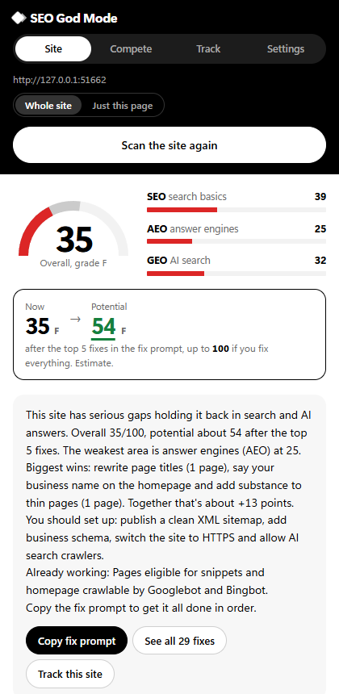
  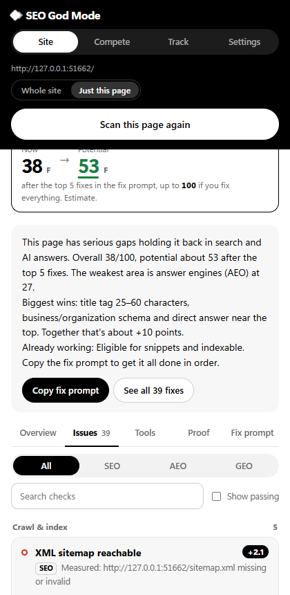
  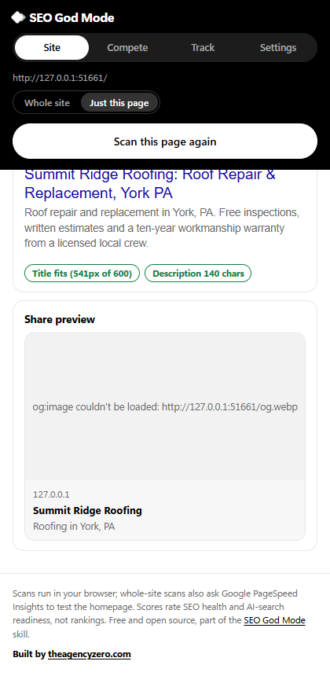
  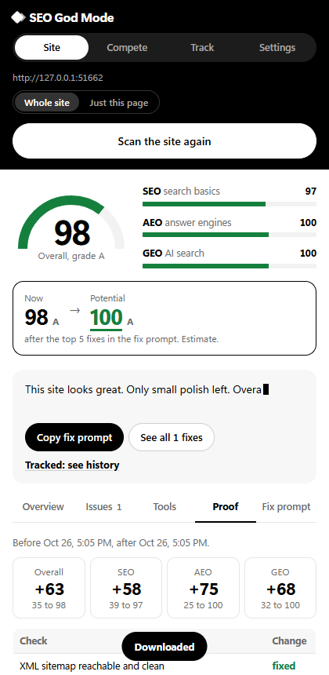
  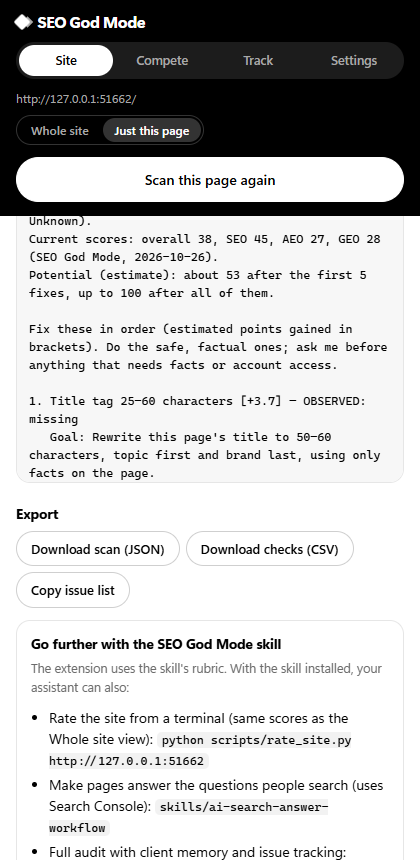
  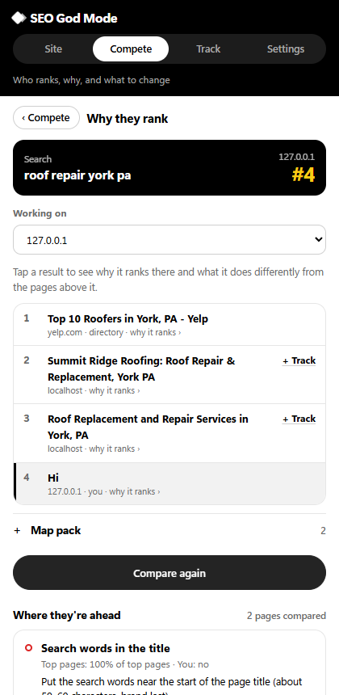
  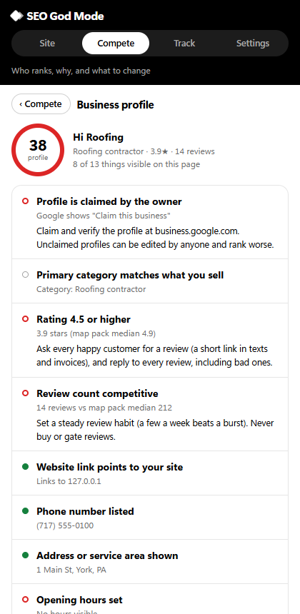
  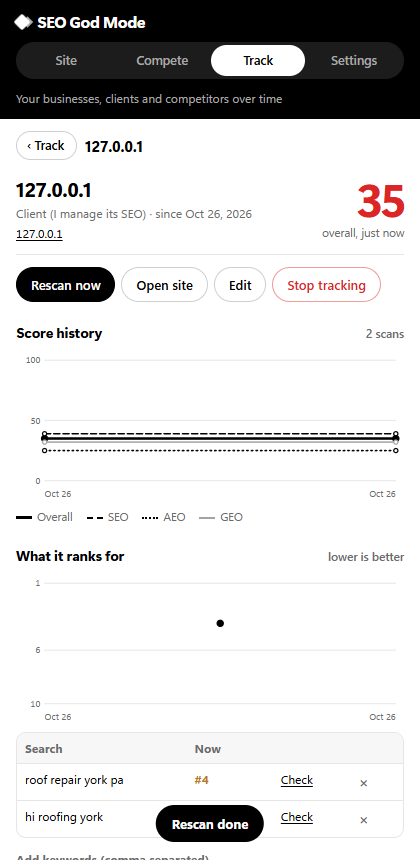
  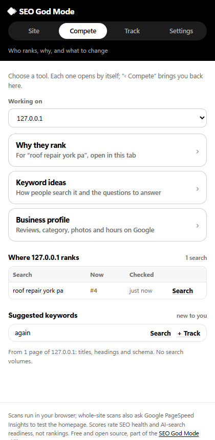
  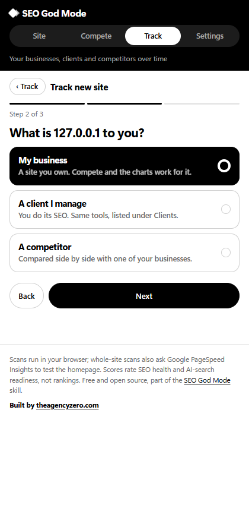
  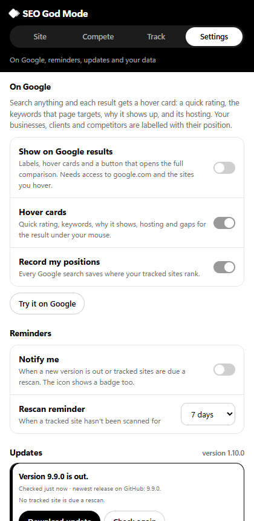

## Install (2 minutes, no store needed)

1. **[Download the extension zip](https://github.com/F0rger123/CLAUDE-SEO-GOD-MODE/releases/latest/download/seo-god-mode-extension.zip)** and unzip it.
2. In Chrome, open `chrome://extensions` and turn on **Developer mode** (top right).
3. Click **Load unpacked** and pick the unzipped folder.
4. Pin the extension, open any website, and click its icon. The side panel opens; press **Scan the whole site** (or switch to **This page**).

The first scan of each site asks for access to that site (both its `www` and non-`www` address, so the redirect check works). It works with Chrome 116+ and other Chromium browsers (Edge, Brave, Arc).

## Four views

- **Site** (default): crawls up to 30 pages the way the skill does, then scores 39 checks with rubric v2.0. Fixes are ranked the same way as the skill (points gained × impact) and list the affected pages. Shows your score now and your potential score after the fixes, plus the site's **hosting and tech**. **Just this page** switches to 78 detailed checks on the page you're viewing, plus 8 tools.
- **Compete:** where you rank for every search you've made, suggested keywords, and three tools: why other pages outrank you, keyword ideas, and a Google Business Profile audit (below).
- **Track:** the websites you follow, with score history, keyword positions, hosting and tech. **Track new site** adds one step by step.
- **Settings:** SEO God Mode on Google results (below), reminders, updates, and export/import.

The panel is black and white, with colour only for ratings: green for good (85+, passing, top 3 on Google), amber for fair, red for poor. Marks also differ in fill (solid passing, half partial, hollow failing), so they read without colour too. Any tracked site or keyword has a × to stop tracking it and delete its history.

## Hosting and tech

For any site you scan or track, and on every Google hover card: what it's built with (WordPress, Shopify, Wix, Squarespace, Webflow, Framer, Next.js, Astro and more, plus page builders like Elementor), its hosting and CDN (Cloudflare, Vercel, Netlify, WP Engine, Kinsta, AWS, Google Cloud and more), the web server, the DNS and email providers (from public DNS records), and tracking tools (GA4, Tag Manager, Meta Pixel, Clarity, CallRail...). Everything comes from the homepage's headers and code and from public DNS; a host worked out from name servers is marked "probably".

## On Google

Turn it on once in **Settings → On Google**. Then every Google search shows:

- **Labels** above results that are your site, a client or a competitor, with their position ("Your client · #4"). They follow Google's light or dark theme.
- **Hover cards:** rest the mouse on any result. It's read and compared with up to three results ranking above it (for #1, the ones right below) on the same 21 on-page factors as Compete. You get a **search match** score, the site's full rating if you've scanned it, why it ranks there, a side-by-side table with those pages, what they do differently, its hosting and what it's built with, **Copy fix prompt**, and **See full breakdown**.
- **See full breakdown** opens that result in the side panel: why it ranks, what the pages above it do differently with the fix for each, every factor side by side, a fix prompt, **Rate the whole site** (runs the full 39-check rating) and **Track as competitor**. In Compete → Why they rank, every result opens the same breakdown.
- A **launcher** in the corner with your position for the search; click it to open the full comparison in Compete.
- **Automatic position tracking:** each search records where your tracked sites rank, for the charts in Track.

You can switch hover cards and automatic positions off, and turn on **notifications** for new versions and for tracked sites that are due a rescan (every 3, 7, 14 or 30 days). A badge on the extension icon shows the same. The overlay only reads the results page; it never runs searches.

## Compete

Search what you want to rank for on Google as normal, open the panel and pick **Compete**. The extension reads the results page you opened; it never runs searches by itself.

Compete opens on a home screen: **where your site ranks** for every search you've made (position, change since last time, when it was checked), **suggested keywords**, and the three tools. Each tool opens on its own with **‹ Compete** to go back, and long results (every factor, top pages, the brief) fold away until you open them. Opening Compete on a Google results page goes straight to Why they rank.

- **Why they rank:** where your site sits ("#4" or "not in the top 10"), the top results with directories (Yelp, Angi, Houzz…) and ads skipped, and the map pack. **Compare** reads the top pages and puts each factor side by side with yours: search words in the title, H1, opening paragraph, subheadings, description and URL; depth, sections, questions, lists; business, FAQ, review and breadcrumb schema; internal and source links; phone link; alt text; server speed; HTTPS; text readable without JavaScript. You get "where they're ahead" with the fix for each, topics they cover that you don't, questions to answer (People also ask plus their headings), a **content brief** (target length and sections, topics, questions, schema), and a **Copy fix prompt**. Backlinks, domain age and clicks are listed as not measured.
- **Suggested for your site:** Compete reads your own pages (titles, headings, Service and LocalBusiness schema) and suggests what you're trying to rank for, such as "roof repair york pa". Keywords you already track or have searched are left out, so every suggestion is new. One click searches it on Google, gets keyword ideas for it, or tracks it.
- **Keyword ideas:** type a keyword and your page. It expands the keyword with Google autocomplete (plus People also ask and related searches when you're on that results page), groups ideas into questions, buyer searches, comparisons and related, shows whether your title, headings and body cover each one, and lists the changes to make. Ideas you already track are left out. Ideas show what people type, not volumes.
- **Business profile:** open your business on Google Maps, or search its name so the panel shows beside the results. It checks whether the profile is claimed, the primary category, rating and review count against the map pack, website link, phone, address or service area, hours, photos, description, posts, Q&A, and keyword-stuffed names, then gives a fix prompt. Anything not visible on screen shows grey instead of a guess.

## Track

**Track new site** asks one thing at a time: the address, what the site is to you, whose competitor it is (for competitors), and which searches it should rank for (suggested from its own pages; tick the ones that matter). Mark each site as **My business**, **Client (I manage its SEO)** for agencies, or **Competitor** (linked to the business it competes with). The list is grouped that way. Open a business or client to see **You vs competitors**: everyone's latest Overall, SEO, AEO and GEO side by side, an overall-score chart with all of them, the checks where a competitor is clearly ahead (with the fix and points it's worth to you, plus a fix prompt), and a search-position table for your keywords across all of them. **Rescan** the business and its competitors in one go. In Compete, "+ Track" on any result adds that site as a competitor of the business you picked.

Add any website and it's scanned straight away. Every whole-site scan of a tracked site adds a point to its score chart (overall, SEO, AEO, GEO), and every Google search you analyze in Compete records where each tracked site ranks, so you get a keyword position chart too. Click a site for its full history, keywords and scans. History is stored in Chrome on your computer (with unlimited storage) and survives updates; **Export history** backs it up and **Import history** merges it on another computer.

## Updates

- **From the Chrome Web Store:** Chrome updates it automatically.
- **Unpacked (Load unpacked):** Settings shows when a new version is out, when it last checked, and the newest version on GitHub; **Check again** asks GitHub right then and recounts the tracked sites due a rescan. Either download the zip, unzip it over your extension folder and press **Reload extension**, or turn on **one-click updates** once: allow the updater, paste the command it shows into a terminal (needs Python 3). After that, **Update now** downloads the release, checks it against GitHub's SHA-256 checksum, installs it into the same folder and reloads. It refuses downloads from anywhere but GitHub, zips that aren't SEO God Mode, and files that would land outside the folder. Your history is kept either way, because it lives in Chrome's storage, not in the folder. Remove the helper with `python "%LOCALAPPDATA%/SEOGodMode/updater.py" --uninstall` (macOS/Linux: `~/.seo-god-mode/updater.py`).

## The summary

After a scan the panel types out a short verdict ("This site looks good, with a few gaps worth closing"), the weakest area, the biggest wins with how many pages each touches, the one-time things you should set up (sitemap, HTTPS redirects, business schema, AI crawler access, Bing), and what's already working. Click it to skip the animation; reduced-motion settings show it instantly. **Copy fix prompt** sits right under it.

## What it checks

**Whole site (39 checks, same as `rate_site.py`):**

| Area | Checks |
|---|---|
| **SEO** | Crawl & index: homepage crawlable, HTTPS, one canonical host, clean sitemap, pages return 200, indexable, real 404, canonicals, no broken/redirected internal links, server-rendered. On-page: titles, descriptions, one H1, heading order, alt text, viewport + lang, social cards. Content: 250+ words, 2+ internal links, HTML under 1 s. Schema: business entity, valid JSON-LD, page-level schema. Performance: PageSpeed Insights mobile score, or an estimate when it isn't available |
| **AEO** | Snippet eligibility, question headings, a direct answer up top, FAQ matching its schema, H2 sections, content in raw HTML |
| **GEO** | AI search crawlers in robots.txt, CDN/firewall blocking of AI crawler user-agents (tested live), business name on the homepage, location, sameAs, About and Contact, contact details, cited sources, Bing access, llms.txt (info only) |

**This page (78 checks):**

| Area | Checks |
|---|---|
| **SEO** (50) | Crawl & index, on-page, links and images, speed (LCP, CLS, TTFB from your visit), structured data |
| **AEO** (12) | Snippet eligibility, image previews, direct answer, definition sentence, question headings, FAQ, quotable paragraphs, walls of text, sections, lists/tables, reading level, freshness |
| **GEO** (16) | AI search and user-fetch crawlers, Bing, business schema and details, sameAs, knowledge-graph profiles, location, contact, About/Contact, author/date, sources, figures, reviews, llms.txt |

Scores are out of 100 per area. **Overall = 60% SEO + 20% AEO + 20% GEO.** Every result is tagged **Measured**, **Estimate** or **Not measured**. Nothing is guessed.

## Tabs

- **Overview:** the biggest wins, a per-area breakdown (tap a row to jump to those issues), and site or page facts, including what a public scan can't see.
- **Issues:** every failed check grouped by area, with filters, search and a "show passing" toggle. Each one explains why it matters, gives steps, lists the affected pages, and has a **Copy fix prompt** button.
- **Tools:** Google result preview, share preview, heading outline, schema inspector, a 17-crawler access table, links, images, page facts and quick links.
- **Proof:** mark a scan as "before", fix things, scan again. You see score changes and every check that was fixed, improved or slipped, and can download a dated report. Site and page scans keep separate histories.
- **Fix prompt:** one prompt for every fix in order, with the affected pages and ready-made snippets (robots.txt groups, starter schema, title and description lists), plus exports (JSON, CSV, issue list). The prompt's rules: no invented facts (`[CONFIRM]`), keep the design, verify the live page, do HTTPS/redirects in the CDN when there is one.

## Privacy

Scans run in your browser and history stays in `chrome.storage.local` on your device. Outside the site you scan, it only contacts: Google PageSpeed Insights (the homepage URL, on whole-site scans), the Google results or Maps page you open (read on screen, only when you use Compete), the pages ranking there (to compare them), Google autocomplete (the keyword you type, for keyword ideas), and GitHub (to check for updates). The CDN/firewall check briefly sets a crawler user-agent on requests to that homepage. There's no analytics and no account. Full policy: [docs/PRIVACY.md](../docs/PRIVACY.md).

## Limits

- Rankings, traffic, index status, backlinks and AI citations aren't visible from outside. Connect Search Console and Bing through the skill for those.
- Page-view speed comes from your own visit. PageSpeed Insights can hit its shared quota; the score then uses the labeled estimate, same as the skill.

## Develop

- Compete and Track: `views.js`, `lib/google.js` (reads results pages and business panels), `lib/compete.js` (comparisons, keyword ideas, profile audit), `lib/track.js` (history and charts), `lib/update.js` and `scripts/updater/install_updater.py` (updates).
- Code: `lib/siterate.js` (whole-site rating, a port of `scripts/rate_site.py`), `lib/pyparse.js` (HTML facts read the way the skill's Python parsers read them), `lib/collect.js` (runs in the page), `lib/site.js` (robots.txt with Google's matching rules), `lib/rubric.js` (page checks), `lib/summary.js` (typed summary), `lib/prompts.js`, `lib/proof.js`, `sidepanel.*`.
- **Change a whole-site check:** change `scripts/rate_site.py` and `lib/siterate.js` together. The parity test fails until they agree.
- **Add a page check:** one entry in `CHECKS` in `lib/rubric.js`, then extend the fixtures in `tests/e2e.mjs`.
- **Test:** `npm i playwright && npx playwright install chromium`, then `node extension/tests/e2e.mjs` (needs Python for the parity step). It runs `rate_site.py` and the extension on the same good and bad sites and compares every score, check and top fix; then scans both views through the real side panel, checks the summary and fix prompts, fixes the bad site and checks the proof report. CI runs it on every push.
- **Chrome Web Store:** listing copy, images, permission justifications and privacy policy are in [`store/LISTING.md`](../store/LISTING.md). Build the upload with `python scripts/build_extension_zip.py`.
- **Releases:** every change to `extension/` on main runs the test, then publishes `seo-god-mode-extension.zip` to GitHub Releases.
